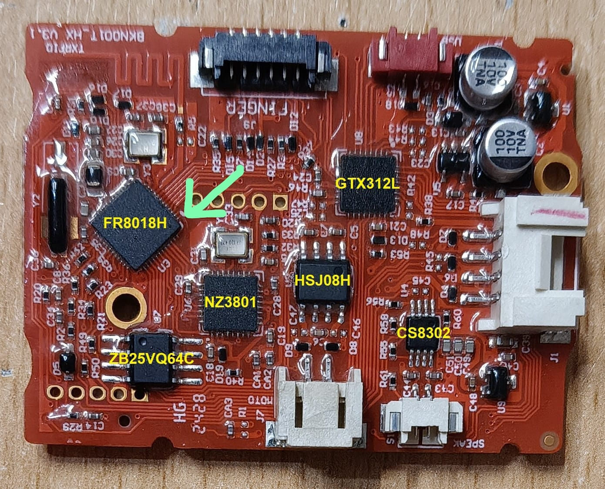
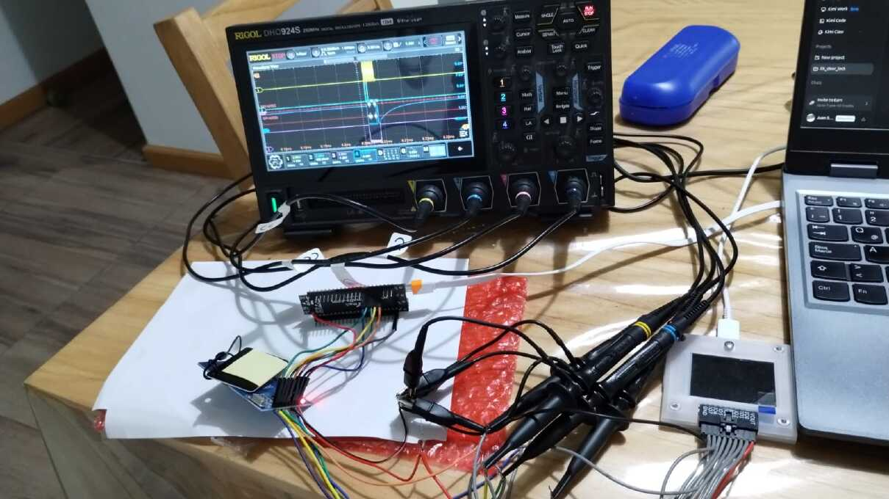
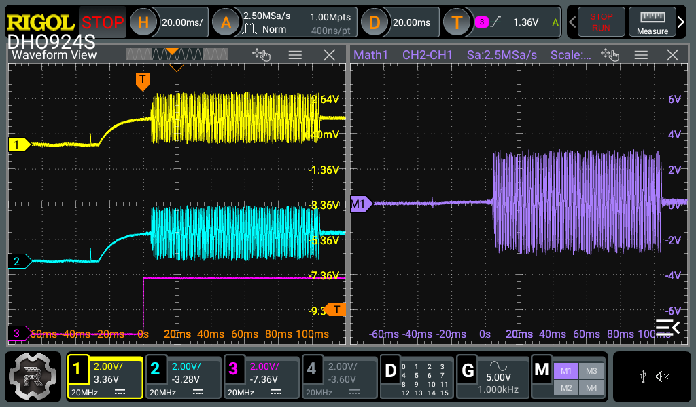

## Part 1 — Technical Empathy

> This is the second article in a five-part series documenting the ES242F Smart Lock project. [Part 0](../) covered why velocity without context is dangerous, and how a method emerged to keep the map intact while the code grew.

---

### The Problem

You have a device in your hands. It works. It locks. It unlocks. It reads fingerprints and RFID cards. But you cannot modify it, extend it, or understand it. There is no datasheet. No API. No manufacturer support. The only thing you own is the plastic shell and the PCB inside it.

This is the standard condition of consumer IoT hardware. The Tuya ecosystem — a platform that powers millions of smart devices — is designed for white-label manufacturing, not for modification. The OEM buys a reference design, adds their branding, and ships it. The end user gets an app and a cloud connection, but no documentation about how the device works internally.

For the ES242F project, this was the starting point. I had a working electronic lock and a decision to make: either use it as-is, tethered to a cloud I do not control, or replace the brain and keep the body. I chose the second option. But before I could write a single line of firmware, I needed to understand what I was looking at.

That is what this article is about: not how to write firmware, but how to study hardware you did not design, when the person who designed it is not available to ask.

---

### Reverse Engineering Is a Conversation

The phrase "reverse engineering" carries a certain drama. It suggests extraction, decryption, the unlocking of secrets. That is not what happens on a bench. What happens is closer to reading someone else's code without comments: you look at the structure, you infer the intent, and you build a mental model of the decisions that led to this particular arrangement of traces and components.

I prefer to call this **technical empathy**. You are not attacking the device. You are trying to understand how the person who built it thought. Why this MCU and not another? Why does the keypad run at 37 kHz instead of the standard 100 kHz I2C? Why three separate LDOs instead of one shared regulator? Every component is a decision, and every decision is a clue.

The AI helped in this phase, but not the way most people imagine. It did not "discover" anything. It structured my own observations into testable hypotheses. I would describe what I saw on the PCB — a chip with this marking, a trace with this width, a connector with this pin count — and the AI would suggest what it might be. Then I would test the hypothesis with a multimeter, an oscilloscope, or a logic analyzer.

The AI proposed. The bench decided. This rule, established in the first hours of the project, would govern every subsequent stage.

---

### The PCB as a Document

The first step was the simplest and the most important: look at the PCB.



The board contained six major components, each with a specific role:

1. **FR8018H** — The main MCU. A Freqchip Bluetooth LE 5.1 SoC running Tuya firmware, with an embedded audio CODEC. This was the brain I would eventually replace with the ESP32-S3.
2. **NZ3801-AB** — The RFID/NFC reader chip. A pin-compatible clone of the NXP MFRC522, handling 13.56 MHz communication with Mifare cards.
3. **ZB25VQ64C** — External SPI flash memory. 8 MB SPI NOR, storing firmware and voice prompts, sharing the SPI bus with the NZ3801.
4. **GTX312L** — Capacitive touch sensor controller. Manages the 12-button keypad over I2C.
5. **HSJ08H** — Actuator driver. Single-channel H-bridge for the lock/unlock mechanism.
6. **CS8302M** — Audio amplifier. Mono class-D, driving the speaker from the FR8018H's differential analog audio output.

The AI suggested these identifications based on the silkscreen markings and package types. But each one required verification. The FR8018H was confirmed by tracing its pinout and peripheral buses. The NZ3801 was confirmed by reading its VersionReg: `0xB2` — not a genuine NXP MFRC522 (`0x91` or `0x92`), but a clone from the same silicon family. The GTX312L was confirmed by capturing I2C traffic when keys were pressed.

In every case, the AI's hypothesis was directionally correct but imprecise. It said "Mifare reader on SPI, probably 4 or 8 MHz"; the sniffer and scope said "MFRC522 clone at 6.06 MHz, SPI Mode 0, with a specific initialization sequence." It said "capacitive sensor"; the scope said "I2C at 37 kHz, 7-bit slave address 0x59, relying on weak internal pull-ups." The AI gave me a starting point. The instruments gave me the truth.

---

### Evidence 1: The Mifare Reader — A Clone in Disguise

The NZ3801-AB was the first peripheral we attacked. The marking meant nothing — no public English datasheet, scarce search results. But the pinout told a story: SCK, MOSI, MISO, CS, NRSTPD, IRQ, TX1, TX2, RX. That is the exact pinout of the NXP MFRC522, the most cloned RFID reader in the world.

Three independent lines of evidence confirmed the hypothesis:

1. **Register map match.** Comparing the addresses accessed by the OEM firmware against the MFRC522 datasheet: CommandReg, ComIrqReg, FIFOLevelReg, FIFODataReg, TxControlReg — every register mapped one-to-one.
2. **ISO14443-3 fingerprint.** The sniffer captured the classic sequence: WUPA (`0x52`) → Anticollision Cascade 1 (`0x93 0x20`) → Select Cascade 1 (`0x93 0x70` + UID) → SAK. Pure MFRC522 behavior.
3. **VersionReg reads `0xB2`.** Genuine MFRC522 silicon returns `0x91` or `0x92`. The value `0xB2` identifies the clone family — the exact same silicon found on inexpensive RC522 breakout modules, which allowed us to validate our driver on a bench module before touching the lock PCB.

The SPI clock measured 6.06 MHz — suggesting the FR8018H derives its SPI from a 48 MHz PLL with an integer divisor. For strict OEM parity, our ESP32-S3 driver was configured for the same 6 MHz.

But the most important discovery was not the chip identity. It was what the OEM firmware did with it.

#### The Power Management Secret

The FR8018H does not leave the NZ3801 powered continuously. It controls the **NRSTPD** pin using a two-mode policy:

- **Mode A — No cards enrolled (touch-gated):** NRSTPD stays LOW indefinitely. The reader is completely off — no RF field, drawing less than 10 µA. Only when the GTX312L keypad detects a touch and wakes the CPU does the firmware fire 5–6 polling bursts at ~1 second intervals, then return to full idle.
- **Mode B — At least one card enrolled (continuous 1 Hz polling):** The firmware switches to a permanent 1 Hz loop. Every second, the CPU raises NRSTPD, runs a lightweight ~2.2 ms idle burst (configure registers, turn antenna ON, fire a WUPA, poll Status2Reg ModemState), and immediately drops NRSTPD LOW if no card answers. Only if a card responds does it branch into the full ~30 ms transaction.

Even in continuous mode, the reader spends >99% of its time in hard power-down between bursts.

Why power down completely? Two reasons: save battery, and **share the SPI bus safely**. The NZ3801 and the ZB25VQ64C flash share the same SPI pins. When the CPU powers down the NZ3801 (NRSTPD LOW), it also drives CS and all SPI pins LOW to prevent parasitic back-feeding through the reader's internal ESD diodes. This releases the bus for flash access during the ~1 second gaps.

#### The Sniffer Problem — And How the AI Solved It

This power-management strategy broke our first sniffer.

A standard SPI sniffer assumes one rule: **CS low means the slave is selected.** When CS goes low, the sniffer starts capturing. When CS goes high, it stops. Simple, reliable, universal.

But the OEM's driver violates that rule. When the CPU puts the reader into hard power-down (NRSTPD LOW), it parks the chip-select line LOW. The reader is asleep, but the pin is physically low. So when the CPU talks to the flash, the sniffer sees CS low and thinks "this is RFID traffic." It captures flash commands, misattributes them to the NZ3801, and produces garbage.

We spent hours staring at captures that made no sense. Register writes to addresses that did not exist. Data bytes that matched no protocol. The sniffer was not broken — it was answering the wrong question.

The solution was to change the question. Instead of asking "is CS low?" the sniffer needed to ask "is CS low **and** is the reader actually awake?" The only signal that knows that is **NRSTPD**. When NRSTPD is high, the reader is powered and its SPI interface is active. When NRSTPD is low, the reader is in hard power-down. The sniffer should capture only when both conditions are true: `CS == LOW && NRSTPD == HIGH`.

This required rewriting the sniffer firmware. The RP2040's PIO peripheral — programmable state machines that sample digital lines at deterministic clock rates — was the right tool. But PIO assembly is not something you write casually. You need to manage the state machine, handle the dual-condition gating, push words across a FIFO between cores, and stream them over USB without dropping frames.

The AI generated the PIO assembly and buffer scaffolding in minutes. It proposed the dual-condition gating logic, calculated buffer sizes based on burst lengths, and structured the USB output format. What would have taken a full day of datasheet archaeology took an afternoon of iteration: AI proposes, scope validates, AI refines.

But the real power of this approach is not just speed. It is the **tool economy**. The RP2040 (Raspberry Pi Pico) costs ~$4. The BusPirate 5 costs ~$30. Both use the same RP2040 chip, so the same PIO firmware runs on both (with a small 74HC595 buffer initialization added for the BusPirate 5).

A commercial logic analyzer capable of stateful multi-pin hardware gating costs hundreds of dollars and locks you into proprietary software. Our tool cost $4 and ran open-source C and PIO assembly we could modify in real time. When we needed to add NRSTPD gating, we changed a handful of PIO instructions.

This is what AI unlocks on the hardware bench: it makes it practical to build custom instruments for specific physical problems in an afternoon.

#### From SPI to UART — The Same Firmware, Reformed

The same pattern repeated with the fingerprint reader.

The fingerprint module uses UART at 57600 baud — a simple two-wire protocol compared to SPI. But capturing UART bidirectionally (both TX and RX simultaneously, with exact chronological interleaving) is not trivial if you want microsecond-level correlation between command and response.

Instead of building a new tool from scratch, we **reformed the SPI sniffer architecture**. The PIO state machines and the dual-core FIFO were repurposed to sample two independent serial lines simultaneously. The AI helped refactor the PIO code: replace the CS && NRSTPD gating with start-bit edge detection on TX and RX, scale the clock divider to 57600 × 16, and tag each byte with its direction (`[T:...]` vs `[R:...]`).

The port took a couple of hours. The first sniffer (SPI) was the investment; the second sniffer (UART) — and later a third one for I2C with a dedicated 5th PIO state machine tracking the keypad's INT line — were the dividends.

#### The Smoking Gun: MFAuthent

Our initial notes stated: "the OEM apparently only reads the UID." A reasonable assumption — many low-cost access systems do exactly that. But reading the complete decoded sniffer log revealed something unexpected:

```
[WRITE] FIFODataReg  | 0x60 0x00 0x04 0x01 0x07 0x00 0x05 0x09 0xC5 0x09 0x98 0x03
[WRITE] CommandReg   | Command Issued -> MFAuthent Instruction
```

Twelve bytes loaded into the FIFO, then command `0x0E` — **MFAuthent**, the Mifare Classic Crypto1 authentication handshake.

Was the OEM actually authenticating Sector 0? We ran a 3-card matrix on the bench (an enrolled Tuya card, an unenrolled Tuya card, and a generic blank Mifare card) and inspected the registers after MFAuthent.

In every single case, reading Status2Reg 12 ms after MFAuthent returned `0x00` — the Crypto1On bit was never set. Authentication **always failed**, even for the legitimate enrolled card. Furthermore, no block read or write command was ever issued afterward, and capturing a full card-enrollment session proved that enrollment writes nothing to the card (confirmed later by dumping the enrolled card: all 16 sectors still had factory keys and zeroed data blocks).

Yet the enrolled card opened the lock. The OEM firmware issued MFAuthent with a hardcoded key, ignored the failure, and granted access purely by matching the 4-byte UID in local flash.

The MFAuthent call was **vestigial** — either left over from an unfinished SDK template or security theater. Discovering this on the wire directly shaped our own security architecture: we kept the OEM's proven physical RF initialization and timing, but replaced the vestigial check with real multi-sector authentication, diversified keys, structured tokens, and anti-replay counters.

Here is what a raw sniffer capture of an enrolled card transaction looks like — compact format, each frame bounded by S (CS low) and P (CS high), with interleaved MOSI/MISO hex bytes:

```
[11:17:16.852] S8200FF20P
[11:17:16.852] S1800100CP
[11:17:16.852] S22103F10P
[11:17:16.852] S463F0062P
[11:17:16.852] S4A008064P
[11:17:16.852] S6C804076P
[11:17:17.410] S2A404014P
[11:17:17.410] S02400000P
[11:17:17.410] S28000314P
```

The `rfid_decoder.py` script translates this stream into human-readable register operations, FIFO pushes, and status polls. Without the decoder, the raw hex is impenetrable. Without the NRSTPD-gated sniffer, the decoder has nothing clean to translate.



---

### Evidence 2: The Fingerprint Sensor — Custom Firmware and the Offline-First Rule

The fingerprint module was a round capacitive sensor on a 6-pin connector: VCC (switched 3.0 V rail), GND, TX, RX, TOUCH_OUT (wake IRQ), and VIN/EN. The silkscreen and protocol pointed to the **GROW R558-S**, a widely used capacitive module based on the Synochip `0xEF01` packet framing.

The AI suggested UART at 57600 baud, 8N1. The scope confirmed it: TX and RX at 3.3 V logic, idle high, 57600 bps. The first bytes captured matched the standard header: `EF 01 FF FF FF FF`.

Here is a fragment of a valid fingerprint detection session captured by our bidirectional UART sniffer:

```
[T:EF01FFFFFFFF010003010005]
[R:EF01FFFFFFFF07000300000A]
[T:EF01FFFFFFFF01000402010008]
[R:EF01FFFFFFFF07000300000A]
[T:EF01FFFFFFFF0100080401000000630071]
[R:EF01FFFFFFFF07000700000100640073]
```

The `[T:...]` lines are commands sent by the MCU; `[R:...]` are responses. The packet structure is: header, length, instruction code, parameters, and checksum. Decoding this by hand is tedious; the AI helped write a Python parser, but the parser only works because the sniffer captured the raw bytes accurately.

However, inspecting the module's system parameters revealed a custom OEM firmware string: **FPM.TXRF**. When we probed the template transfer commands (UpChar and DownChar) required to replicate a user's fingerprint across multiple doors, we found that UpChar did not return a standard 256- or 512-byte template — it streamed a proprietary **~23 KB binary blob**.

This forced **Decision D16**: an explicit architectural decision bridging hardware reality, offline reliability, and data privacy:

1. **Offline-first verification:** A smart lock must never depend on WiFi or a cloud server to open a door. Local verification (~480 ms from finger touch to match verdict) happens entirely inside the sensor module against its internal flash slots. The lock's local credential_store is the strict authority.
2. **Dual-path replication:** For normal single-lock enrollments, biometric templates never leave the sensor. When multi-door replication is required, our driver supports runtime firmware-variant detection and transports the template over mTLS as an opaque, envelope-encrypted blob that the backend cannot interpret.

The sniffer also revealed two hardware traps that saved us weeks of debugging later. First, the R558-S emits a spurious **~15 ms TOUCH_OUT boot pulse** ~100 ms after its 3.0 V LDO is enabled — the firmware must disarm the wake IRQ before power-cycling the sensor. Second, the RGB "aura" ring around the sensor uses command `0x3C` with specific function bytes (breathing blue, solid green on match, solid red on fail) that we mapped byte-for-byte from the UART logs.

---

### Evidence 3: The Capacitive Keypad — Ghosts and RF Noise at 37 kHz

The GTX312L is a 12-channel capacitive touch controller on the I2C bus at address `0x59`. It reports touch states through two status registers and an open-drain interrupt pin (INT, active-low pulse on every state change).

The first surprise was the bus clock. Standard I2C runs at 100 kHz or 400 kHz. The OEM drives the GTX312L at **~37 kHz**. Why so slow? The answer lies in the pull-ups and the standby current budget.

The GTX312L's internal weak pull-ups (~30 kΩ measured on the board) are enabled, with no stiff external resistors on the PCB. Combined with trace capacitance, a 30 kΩ pull-up produces slow rising edges that would fail timing at 100 kHz, but settle cleanly at 37 kHz. The original designer traded bus speed — irrelevant for human typing — to save two resistors and cut I2C standby current by nearly an order of magnitude.

Here is what a real wake-and-touch event looks like in our I2C sniffer:

```
[23:25:54.491] [INT asserted] t=0388571097
[23:25:54.496] [INT released] t=0388576616
[23:25:54.498] sB2a02asB3a20a00aFFa3Fnp
[23:25:54.527] sB2a20a08a08a08a08a08a08a08a08a08a08a08a08ap
[23:25:54.530] sB2a14a00a01ap
```

Decoding the wire bytes tells the wake story. The CPU reads register `0x02` (TOUCH_OUT low byte) and finds `0x20` (bit 5 = channel K6, which maps to key *). It then writes active sensitivity `0x08` across all 12 channels and sets the scan rate to fast mode (~11 ms), polling every 20 ms until ~5.8 seconds after the last release, when it restores idle sensitivity and goes back to sleep.

#### The Double Trap: Deterministic Column Ghosts and 13.56 MHz RF Coupling

Capturing a full 12-key sweep exposed two severe physical phenomena:

1. **Deterministic downward column ghosts:** Because the OEM enables MULTI_MODE and SLIDE_MODE with aggressive sensitivity, pressing a key frequently couples capacitively into the key directly below it in the same physical column. During a normal press of key 5, the combined value stayed stable for 17 consecutive polls (340 ms). A naive rule requiring "only one bit set" would reject a legitimate press that the OEM accepted.

2. **13.56 MHz RFID antenna interference:** The Mifare loop antenna is routed directly around the center of the touch panel. When the NZ3801 fired RF bursts, the electromagnetic field injected phantom patterns into the keypad — either flooding multiple channels simultaneously or generating bursty single-bit runs synchronized with the RF polling cadence.

The AI initially suggested textbook debouncing: time thresholds or single-key majority filters. The sniffer logs proved why both would fail on this PCB.

By analyzing the exact bit progressions, we formulated an acceptance algorithm grounded in the physical geometry:

1. **Minimum episode length:** A touch must remain non-zero for >= 4 consecutive polls (~80 ms), matching the OEM's measured threshold and rejecting short glitches.
2. **Bitwise intersection across the episode:** Because the human finger always lands on the intended target key first before spreading capacitively to the neighbor below, we compute the bitwise AND across all samples in the episode. If exactly one bit survives, that key is accepted.
3. **Downward column disambiguation:** If more than one bit survives the intersection, we drop any bit whose column-neighbor-above is also set. If exactly one bit remains, it is accepted; if more than one still remains, it is rejected as ambiguous.
4. **Mandatory RF touch masking:** Because a stationary card in the field can induce a stable single-bit phantom that no pure software filter can distinguish from a finger, our scheduler explicitly masks keypad sampling around every NZ3801 RF burst.

---

### Evidence 4: The Motor Driver — Identified by the Market

The actuator that physically unlocks the door was the fourth peripheral. The SOP-8 chip was labeled **HSJ08H 412AX1** — zero Western search results, no public datasheet.

Tracing the PCB by hand showed two control pins (SOL1, SOL2), power from VBAT (~6 V from 4 AA batteries), and a 2-pin connector to the lock case. Initially we wondered: is it a boost converter for a solenoid? Dual PWM in anti-phase?

Western search engines returned nothing. The breakthrough came from **searching Chinese component marketplaces** (Taobao, Alibaba, Sohu, LCSC). A listing for the **Mixic MX608E** described it as *"door lock motor driver chip, replacement for HSJ08"*. The MX608E datasheet revealed an entire pin-compatible family: HSJ08 / MX608E / HR1124S / TC118S / YX9020AM / LGM9680.

The MX608E is a single-channel H-bridge with integrated N- and P-channel MOSFETs, operating from 2.0 to 9.6 V, 1.1 A continuous current, and standby current under **0.1 µA**. Its truth table is straightforward:

| INA (SOL1) | INB (SOL2) | Output | State |
|---|---|---|---|
| L | L | Hi-Z | Coast (standby) |
| H | L | OUTA=H, OUTB=L | Forward (Extend / Unlock) |
| L | H | OUTA=L, OUTB=H | Reverse (Retract / Relock) |
| H | H | Both=L | Brake (Low-side short) |

Connecting the Rigol scope during a card-open event settled every question:
- A valid credential triggers a flat DC **235 ms pulse on INA** — the actuator extends, coupling the exterior handle to the latch.
- After a **4.58 second dwell window**, a **235 ms pulse on INB** retracts the pin.
- After each pulse, both inputs return LOW (Coast / Hi-Z), with the back-EMF flyback tail visible on the scope before settling.
- The "solenoid" was not a solenoid at all: it was a **reversible geared DC motor** driving a clutch pin open-loop by time, relying on a mechanical slip clutch at the end-stops.
- At power-up, the OEM fires a single **240 ms INB (retract) pulse** — a mandatory drive-to-known-home sequence for an open-loop actuator recovering from a battery swap.

The AI was useless for identifying the HSJ08H. It could not cross-reference Chinese e-commerce listings with an SOP-8 pinout trace. That identification was pure human detective work — followed immediately by scope verification.

---

### Evidence 5: The Audio System — CODEC, Flash Dump, and Complementary MCPWM

The audio subsystem was the most intriguing peripheral to reverse-engineer because the signal path started inside flash memory, passed through the MCU's silicon, and ended at a differential analog amplifier.

The **CS8302M** is a mono class-D audio amplifier driving an 8 Ω mini speaker, with an active-low shutdown pin controlled by the CPU. Scoping its inputs showed a **~3.3 Vpp differential analog waveform** coming directly from the FR8018H, which integrates an internal audio CODEC.

Where did the digital audio live? We clipped an in-circuit programmer onto the **8 MB ZB25VQ64C SPI NOR flash** and dumped its contents three times, verifying identical SHA-256 hashes.

Here, the AI was a massive force multiplier. Feeding the binary structure into the session, the AI helped identify the container format and wrote the extraction tooling:

1. It parsed the proprietary lookup tables to extract **1,004 audio clips** organized across **10 language packs** (Chinese, English, Vietnamese, Portuguese, Arabic, Russian, Thai, Spanish, Indonesian, German), encoded as **8 kHz, 4-bit IMA-ADPCM** in 256-byte blocks.
2. It built a Python transcription pipeline that cross-referenced the original Chinese and English prompts against the Spanish pack. This exposed several broken Spanish translations in the OEM firmware (for example, "user not found" translated as *"usuarios vacíos"*, or passage mode mistranslations).
3. It helped us validate a bit-exact IMA-ADPCM C decoder against ffmpeg across all 1,004 clips, plus a new-prompt generation pipeline so we could fix the broken Spanish phrases and store the corrected pack directly inside an internal flash partition on the ESP32-S3 — allowing us to eliminate the external ZB25VQ64C chip entirely.

How do you drive the CS8302M's differential analog inputs from an **ESP32-S3**, which has no internal audio DAC/CODEC?

Instead of adding an external I2S DAC chip, we used the ESP32-S3's **MCPWM peripheral in complementary differential mode**:
- Two GPIOs output complementary **156.25 kHz, 10-bit PWM** waveforms directly into the CS8302M's existing RC input network (20 kΩ / 10 µF), which naturally filters the carrier and reconstructs the differential audio swing.
- A hardware timer ISR running at **32 kHz** (4× oversampling from the 8 kHz ADPCM decoder) updates the duty cycle sample-by-sample.
- An anti-pop duty ramp and routing AMP_SD to strapping pin IO46 (whose native boot pull-down keeps the amplifier muted during reset) eliminated startup clicks completely.



---

### The Power Architecture — Three LDOs and One Physics Constraint

Tracing the power tree revealed three separate LDO regulators, and each one represents a deliberate engineering trade-off:

- **LDO 1 (SOT23-3, 3.3 V):** Powers the main digital rail (FR8018H, NZ3801, GTX312L, and status LEDs).
- **LDO 2 (SOT23-3, 3.3 V):** Dedicated exclusively to the CS8302M audio amplifier, isolating class-D speaker current spikes from the digital and RF rails.
- **LDO 3 (SOT23-5, 3.0 V with CE enable pin):** Dedicated to the fingerprint sensor. By choosing an LDO with a chip-enable pin controlled by a CPU GPIO, the designer gained a high-side power switch for free — cutting sensor power completely without adding an external P-MOSFET.

When the lock is asleep, the motor driver is in Hi-Z coast (<0.1 µA), the NZ3801 is in hard power-down (<10 µA), the fingerprint sensor sleeps (<12 µA) with TOUCH_OUT armed, and the GTX312L scans at 330 ms intervals with its ~30 kΩ internal I2C pull-ups. Every microamp was accounted for.

However, this power tree also exposed a critical physical constraint. Even if a LDO is rated for 500 mA on paper, its tiny SOT23-3 package has a thermal dissipation limit of roughly **300 mW**. Dropping 6.0 V to 3.3 V limits continuous current to ~100 mA before thermal shutdown. That is plenty for a BLE-only FR8018H, but fatal for an ESP32-S3 whose WiFi transmitter demands ~500 mA peaks.

Understanding that thermal limit before building hardware saved the project from mysterious brownouts — **Decision D43** — our ESP32-S3 adapter board taps the raw battery node ahead of LDO 1 and carries its own dedicated regulator (>=600 mA rating), leaving the three original onboard LDOs untouched.

---

### The AI as a Tool Multiplier

Across all five peripherals, the AI played a consistent role: it accelerated the construction of custom instruments and decoders, while every physical truth came from the bench.

| Task | What the AI Did | What the Human Did |
|---|---|---|
| **SPI sniffer firmware** | Generated RP2040 PIO assembly, lock-free FIFO, and CS && NRSTPD gating logic | Traced the shared SPI bus, discovered the NRSTPD power-down behavior, validated edge capture on scope |
| **UART sniffer firmware** | Refactored the SPI PIO architecture for dual-channel 57600-baud TX/RX capture | Probed the R558-S connector, discovered the FPM.TXRF 23 KB blob and the 15 ms boot-pulse trap |
| **I2C sniffer firmware** | Added a 5th PIO state machine for INT edge timestamping and BusPirate 5 init | Measured the 37 kHz clock and ~30 kΩ internal pull-ups, designed the intersection + column-ghost rule |
| **rfid_decoder.py** | Structured the hex-to-register parser and transaction state machine | Ran the 3-card matrix, proved MFAuthent was vestigial, designed the multi-layer card crypto scheme |
| **Motor driver (lockdrv)** | Generated ESP-IDF driver scaffolding and console test commands | Identified the HSJ08H as an MX608E via Chinese market sources, scoped the 235 ms pulses |
| **Audio subsystem** | Parsed the 8 MB flash dump, extracted 1,004 ADPCM clips, built the pack builder | Scoped the differential analog front-end, engineered the 156.25 kHz complementary MCPWM drive |
| **Test harnesses** | Generated console REPL frameworks, argument parsers, and help tables | Designed the hardware-in-the-loop acceptance suites and verified parity against OEM captures |

The pattern is unmistakable: the AI is extraordinary at generating scaffolding — the PIO state machines, the Python decoders, the CLI harnesses. But the discoveries — the NRSTPD duty-cycling, the vestigial MFAuthent, the MX608E equivalence, the 37 kHz weak-pull-up trade-off, the downward column ghosts, and the SOT23-3 thermal ceiling — came exclusively from the bench.

The AI reduced the time from "I need a custom protocol analyzer" to "the analyzer is streaming decoded frames" from days to hours.

---

### From Sniffer to Test Harness — The Console Method

Understanding a peripheral is not the end of the reconnaissance phase. The end is an **isolated ESP-IDF component library** paired with an interactive **console test harness** that reproduces every behavior observed in the OEM firmware on real hardware before a single line of application code is written.

For example, the Mifare test harness (`mifare_test`) exposes the NZ3801-AB driver through a serial REPL:

```bash
init -m 11 -s 13 -c 12 -C 10 -r 9 -V 0xB2     # initialize SPI at 6 MHz + self-test VersionReg
version                                          # read VersionReg: 0xB2 = NZ3801 clone
select                                           # present a card: UID/SAK/ATQA
auth -b 4 -t a -k FFFFFFFFFFFF                 # authenticate Sector 1 with factory key
read -b 4                                        # read 16-byte block
burst                                            # single ~2.2 ms OEM idle-burst replica
poll -n 20 -p 1000                             # OEM 1 Hz cycle replica
```

Running `poll` with an enrolled card on the antenna produces:

```
I (25392) CMD: cycle 0: CARD DETECTED (ModemState=0x06) — full branch
I (25402) CMD: UID: C5099803 (4 bytes) | SAK: 0x08 | ATQA: 0x0004
I (25422) CMD: OEM probe auth: FAIL (vestigial — FAIL expected)
```

During bench validation, the console harness exposed two silicon quirks of the 0xB2 clone that would have been nightmares to debug inside a full application:

1. **Unreliable ComIrqReg interrupts:** On this clone, RxIRq asserts, but the Transceive command never auto-terminates and the hardware timer never fires. Looking back at our sniffer logs, we realized why the OEM never polled ComIrqReg — it polled FIFOLevelReg and Status2Reg ModemState with software deadlines. Emulating the OEM's exact polling method fixed it immediately.

2. **Self-reception (TX loopback):** On long CRC-enabled frames, the clone's receiver wakes up during its own transmission and fills the FIFO with its own tail bytes ~150 µs into the frame. Adding a single deterministic FIFO flush at TX-end + 100 µs eliminated the corruption.

Every peripheral had to pass a strict wire-verified acceptance checklist in its console harness before closing the stage:
- **fpm (Stage 1):** 7-test suite passed on the wire, touch-to-verdict in ~480 ms, boot-pulse suppression verified.
- **mifare (Stage 2):** 3-card matrix, 3,359 SPI frames captured across 5 poll cycles matching the OEM byte-for-byte, NRSTPD power-down parking all SPI pins LOW.
- **keypad (Stage 3):** 18/18 key presses accepted across a 12-key sweep with column-ghost disambiguation, 20 ms active poll cadence, zero bus traffic in IDLE.
- **audio (Stage 4):** Bit-exact ADPCM decode across all 1,004 clips, glitch-free 156.25 kHz complementary MCPWM playback, zero boot pop on IO46.
- **lockdrv (Stage 5):** 235 ms forward/reverse pulses, 240 ms boot home pulse, and Hi-Z coast verified on the Rigol scope.

The open-source peripheral harnesses and drivers are available on GitHub:
- [mifare_test](https://github.com/jjsch-dev/mifare_test) — Console-based NZ3801/MFRC522 driver and test harness for ESP32-S3
- [gtx312l_keypad](https://github.com/jjsch-dev/gtx312l_keypad) — Event-driven GTX312L capacitive keypad library for ESP32-S3
- [audio_test](https://github.com/jjsch-dev/audio_test) — IMA-ADPCM decoder and complementary MCPWM differential audio harness for ESP32-S3

---

### What We Learned from Not Knowing

The reconnaissance and peripheral-harness phases took approximately two weeks. During that time, we did not write a single line of the final lock state machine or MQTT client. We built probes, sniffers, decoders, and isolated component libraries. We built a mental model of a system we did not design.

Four lessons stood out:

> **The OEM firmware on the wire is the ultimate specification.** Without source code, without datasheets, without manufacturer support — we ended up knowing the exact 6.06 MHz SPI clock, the register-by-register initialization sequences, why ComIrqReg was avoided, the hardcoded MFAuthent key, the two-mode RF power policy, the 235 ms H-bridge timing, and the ADPCM flash layout. All of it was on the traces, waiting to be measured.

> **Hypotheses exist to be falsified, not accumulated.** Our first hypothesis (the NZ3801 is an MFRC522 clone) was proven by three independent lines of evidence. Several other initial assumptions (the OEM authenticates Mifare sectors, the actuator is a solenoid, a single-bit filter is enough for the keypad) were falsified by the instruments and replaced with facts.

> **OEM parity is risk management, not nostalgia.** Replicating 6 MHz SPI, the WUPA polling sequence, and the 37 kHz I2C bus is not cargo-cult engineering. The original firmware is already field-proven across thousands of units with this specific PCB layout, antenna tuning, and battery chemistry. We deviate only when we have a documented security or architectural reason.

> **The instrument is part of the experiment.** Building our own RP2040 PIO sniffers gave us visibility no off-the-shelf analyzer offered at that price — and also taught us that a sniffer gated on NRSTPD hides what happens when NRSTPD is low. Knowing what your instrument filters out is just as important as knowing what it captures.

Once all five peripherals were proven in isolation, we faced the real challenge: integrating them into a single asynchronous firmware application, designing the ESP32-S3 adapter board, and building the cloud backend. That is where a single conversational AI collapsed under its own velocity — and why we had to invent the institutional architecture covered in **Part 2**.

---

*The ES242F project is documented in real time. All evidence, runbooks, and decision records are available in the project repository. This series is written as the project advances; each article is published when the evidence that supports it has been validated on the bench.*
