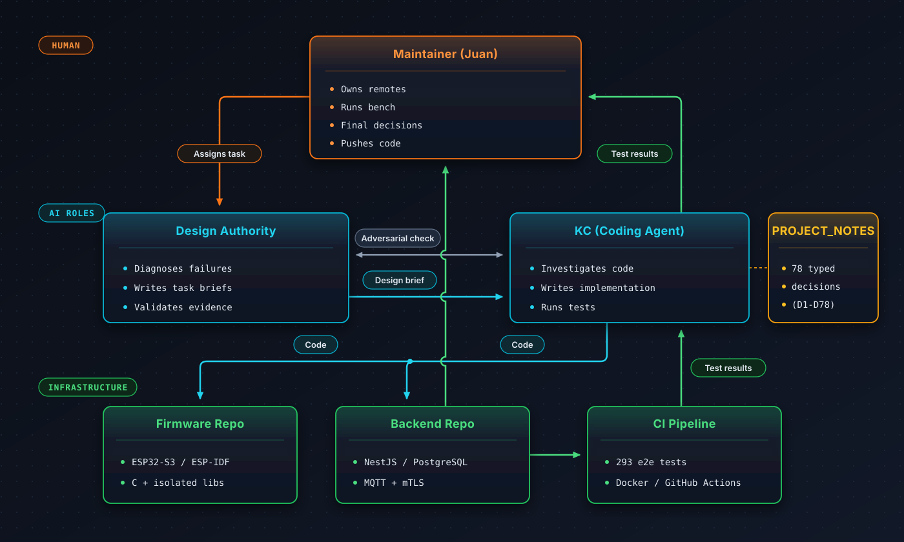
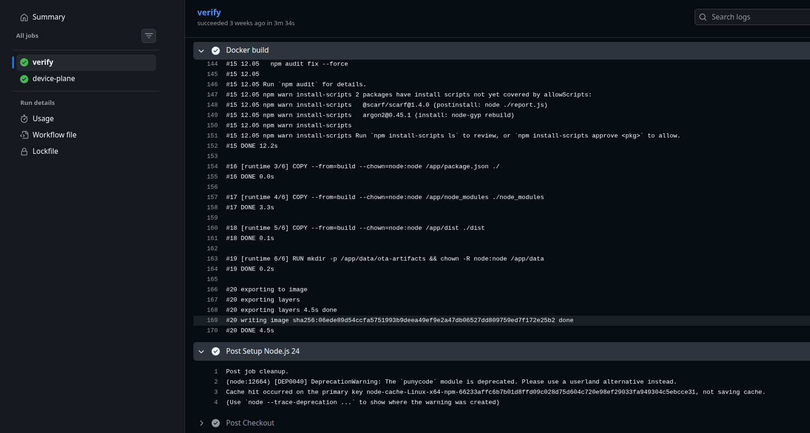
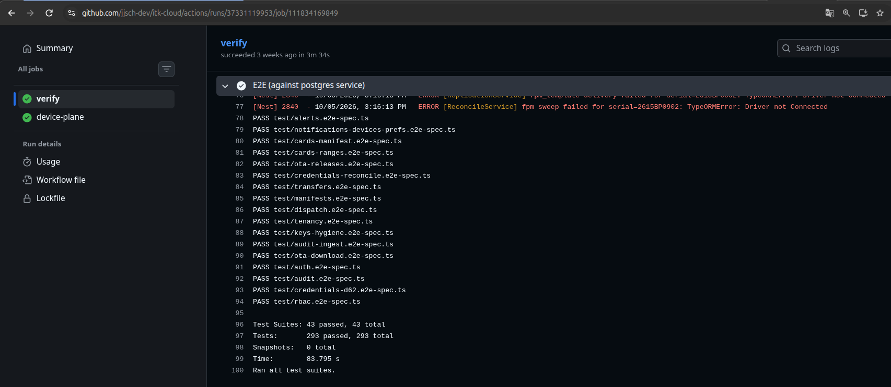
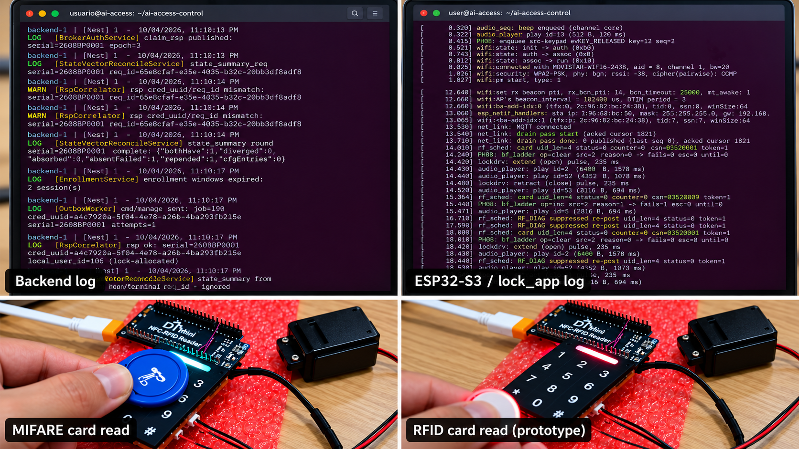

## Part 2 — The Institutional Architecture

> This is the third article in a five-part series documenting the ES242F Smart Lock project. [Part 0](../articles/arco-0-old-workshop) introduced the human–AI contract. [Part 1](../articles/arco-1-technical-empathy) showed how we reverse-engineered five unknown peripherals with sniffer evidence. This article is about what happened when the project outgrew the chat window that created it.

---

### The Plan and the Drift

The ES242F project did not start as vibe coding. It started with a method.

Before writing a single line of firmware for the ESP32-S3, we established seven ground rules. Decision D1: isolated component libraries with a console test harness per stage. D2: OEM behavior parity by default. D4: every protocol fact proven on the wire before it enters the codebase. D7: one development thread per stage; the decision register is the handoff document. The project's memory lives in the repo, not in a chat.

These were not retrospective rationalizations. They were the first decisions in the register, made when the project was still a single peripheral and a single conversation.

The method worked. Stage 1 (fingerprint) closed with a seven-test suite verified on the wire. Stage 2 (Mifare) closed with 3,359 SPI frames matching the OEM byte-for-byte. Stage 3 (keypad) closed with an 18/18 key acceptance sweep. Stage 4 (audio) and Stage 5 (motor) followed the same pattern.

Then Stage 6 arrived: system architecture. And Stage 8: the NestJS backend with PostgreSQL, EMQX, and an early CI milestone of 293 end-to-end tests. The project was no longer a single engineer studying a chip. It was a distributed system with three repositories, two programming languages, and state that lives in flash, RAM, and a database simultaneously.

The method started drifting.

At first the drift was subtle. A coding agent (KC) would implement a backend module and report "tests passing" without a Phase 0 investigation of the existing code. A design brief would describe the solution in prose instead of dictating the exact commit plan. A bench verification would happen, but the runbook would live in the chat history instead of in a file.

The system kept growing. The drift kept accumulating.

Then we tried to build the state vector healer — the mechanism that detects when the lock's credential store diverges from the backend's system of record, and automatically reconciles them. This is where the accumulated drift became visible.

---

### The State Vector Healer: Where the Drift Surfaced

The healer sounds simple: the lock computes a digest of its credential store. The backend independently computes the expected digest from its own records. If they differ, the system has evidence of divergence. But detection is only the beginning: the backend must classify the difference, request a paged summary, reconcile what each side actually holds, and decide which records can be re-pended or absorbed under the established ownership rules. Only then can a missing credential be re-delivered and convergence verified.


This matters because the backend is the system of record for centrally managed credentials, but the lock can also hold locally enrolled, provisional credentials. The protocol cannot simply overwrite every difference. And, under D16, none of this sits on the door-opening path: the lock verifies credentials and actuates locally, even without WiFi. The network is the management and repair plane, not permission to open a door.

Building this required changes in three places: the lock's firmware (credential store digest computation), the backend's heartbeat handler (digest comparison and round scheduling), and the backend's reconcile service (round state machine, page timeout handling, budget counting).


The first detector implementation passed its tests. The bench showed the lock booting, the backend accepting heartbeats, and the state-vector fields populated. Everything looked green. That detector still relied on a mutable, previously observed MAC baseline. It was not yet the independent SHA-256 set digest ratified later as D78.

Then we ran corruption drills. We deliberately corrupted credential records in the lock's flash, rebooted, and watched what happened. The experiments exposed two different layers of failure, at different points in the work: the original detector could absorb corrupted state as its new baseline; after D78 changed the detector, the recovery path still had to contend with poison-accounting, idempotency, and the reconcile budget. These are related incidents, not one bug in one unchanged implementation.

With the independent digest path in place, the lock's boot-time self-check detected the corrupt record, poisoned it, and reported the changed live-set digest. The backend compared that value against its independently computed expectation and classified the mismatch. A drift event was created. A reconcile round was expected.

And then — **silence**. No round completed. No credentials redelivered. The lock stayed divergent.

The investigation documented three failure modes in the recovery train. The detector redesign and these implementation defects must be understood separately.

**Bug 1: The poison counter did not increment on tail corruption.**

When the corrupt record sat at the tail of the log (the last slot before empty space), the boot scan's `s_poison_valid` flag was only set in mid-log conditions. A poisoned tail record was scrubbed but never counted. The firmware reported "credentials lost to corruption: 4" when it should have reported 5.

KC ran Phase 0 properly this time: read `scan_log()` line by line, traced the `s_poison_valid` assignment at `:603-611`, and found the gap documented in a comment at `:596-602` as a "deliberate torn-tail ambiguity." The fix required stashing the poison count not just mid-log, but also when the poisoned tail record had once been live (magic == `CS_MAGIC` and schema version valid).

One targeted falsifier used a corrupt image with an already poisoned corpse at slot 2 and a newly corrupted card at slot 4. In that particular fixture, the expected diagnostic advanced from 4 to 5 after the fix. The idempotency scrub also had to clear the lost record's metadata so a genuine re-delivery could be applied instead of incorrectly classified as a duplicate. This was one fixture; the later integrated drill below had a different starting count.

```
W credential_store: torn/corrupt record @0x280 — poisoning slot
W credential_store: poison scrub: D61 idem entry of the lost record erased
I credential_store: init ok ... credentials lost to corruption: 5
```

**Bug 2: The backend's reconcile budget silently blocked the healer.**

`STATE_VECTOR_MAX_RECONCILES_PER_EPOCH` was set to 3. The counter incremented on every initiated round, regardless of outcome. But page-timeout rounds — for example, a round that receives no page response because the lock is no longer reachable — also consumed budget. After three such timeouts, the auto-reconcile was permanently silenced until the next epoch advance (a re-claim).

Worse: no log was emitted when the budget blocked. Total silence.

The evidence was in PostgreSQL: `reconcile_count = 3`. The heartbeats were arriving. The drift events were being created. But `requestRound()` was never called because `reconcileCount >= max`.

**Bug 3: The backend's unit tests had encoded the bug as expected behavior.**

KC's original test suite passed because it tested the happy path — rounds that complete. It did not test budget exhaustion, timeout rounds, or the interaction between poisoned digests and suppressed auto-rounds. The AI had written tests that confirmed the scenarios it had implemented, not tests capable of falsifying this failure path.

---

### The Trigger: Back to Plan 0

These three bugs were not caused by bad AI. They were caused by a **process that had drifted from its own rules**.

The state vector healer forced a reset. We made the intended sequence for subsequent fixes explicit again:

> In practice, the method was never followed perfectly. The point was not perfection. The point was to build a process that made drift visible and made return to evidence mandatory.

1. **Phase 0 — Investigation (read-only).** KC reads the relevant files and produces a report with exact line numbers, root cause, and a falsifier before any code changes.
2. **Phase 1 — Design brief.** The Design Authority writes a brief with the problem statement, required behavior, constraints, and a commit plan. Never the solution line-by-line.
3. **Phase 2 — Implementation.** KC writes code and tests. One concern per commit. Bench is the final arbiter.
4. **Phase 3 — Review.** Evidence is validated against the brief. Only then does code get pushed.

Here is what that looked like in practice for the backend reconcile budget fix.

#### Example: Phase 0 — Investigation

KC read three files in the backend repository:

- `src/modules/health/state-vector.service.ts` (`observe()`, `classify`, `requestRound`)
- `src/modules/health/state-vector-reconcile.service.ts` (`startRound`, `completeRound`, page timeout)
- `src/modules/health/entities/device-state-vector.entity.ts` (`reconcile_count`, `reconcile_state`)

The report was not "I think the counter might be wrong." It was:

> reconcile_count = 3 in PostgreSQL. STATE_VECTOR_MAX_RECONCILES_PER_EPOCH = 3 in code. Heartbeats arrive, drift events are created, but requestRound() is never called because reconcileCount >= max. Zero logs — total silence.

This is the difference between a guess and an investigation. The report contained exact values from the database, exact function names, and the exact condition that blocked execution.

#### Example: Phase 1 — Design Brief

The brief dictated three changes, all in the backend, with exact rationale:

1. **WARN on budget block.** Before the `reconcile_count >= max` check, emit a warning so suppression is visible.
2. **Do not count page-timeout rounds.** Lack of a response may reflect infrastructure or connectivity, not irreconcilable credential state. Count the budget only on the defined completed-round path; do not charge it for timeout, busy, or early-aborted paths.
3. **Reset count on the specified successful-heal signal.** The patch uses `repended > 0` as its reset trigger. That is an operational rule from this fix, not proof that every completed round has converged; final digest agreement remains the stronger end-to-end check.

The brief also specified the commit message, the constraints (TypeScript, NestJS, TypeORM; do not touch the lock repo), and the verification plan: host tests simulating timeout rounds, repended resets, and true data-failure exhaustion.

#### Example: Phase 2 — Implementation

KC implemented the three changes. The page-timeout fix was structural rather than literal: instead of guarding the increment at request time, the `reconcile_count` update was moved into `completeRound()`'s close UPDATE with a `CASE WHEN` for the defined completed-round path. Timeout, busy, and failed rounds exit via `transitionToIdle` and do not consume that budget. A completed round, however, is not by itself proof of convergence; the post-round state still matters.

At this later backend patch milestone, the test suite had grown to 885 tests across 67 suites. All passed. ESLint clean. Nest build clean.

```
Test Suites: 67 passed, 67 total
Tests:       885 passed, 885 total
Snapshots:   0 total
Time:        ~120 s
```

#### Example: Phase 3 — Review and Bench

The bench falsifier was explicit:

1. Flash the corrupt image with the poison counter fix already merged.
2. Reboot. In this later, integrated corruption fixture, the lock reports `credentials lost to corruption: 6`. This is not the same initial store state as the 4-to-5 counter test above.
3. Connect to MQTT. The backend receives a divergent heartbeat.
4. The auto-round fires (budget was reset on previous heal, so count is 0).
5. The round completes with `repended: 1`; the subsequent state check and actual card operation are used to validate the recovery, not the counter alone.
6. Present the card. **It opens the door.**

```
backend-1 | WARN [StateVectorService] auto-reconcile suppressed: 
            per-epoch budget exhausted (serial=2608BP0001 epoch=3 reconcile_count=3/3)
backend-1 | LOG  [StateVectorReconcileService] reconcile budget reset 
            after successful heal, serial=2608BP0001
```

The WARN line makes suppression observable instead of silent. The reset message documents the recovery policy; neither line substitutes for a bench check.

---

### The Roles: Maintainer, Design Authority, KC

The workflow only works because the roles are separated.



| Role | Who | Does | Does NOT |
|------|-----|------|----------|
| **Maintainer** | Human | Owns the repos' remotes, runs the bench, approves amendments, makes final decisions, pushes code | Delegates final authority over contracts |
| **Design Authority** | AI (analysis role) | Diagnoses failures, drafts briefs and architectural rulings for maintainer approval, reviews evidence against frozen contracts | Changes frozen contracts or exercises final authority independently |
| **KC** | AI (coding agent, one per repo) | Investigates code, writes implementation, runs tests, reports evidence | Decides architecture, pushes to remote |

The separation is not cosmetic. It is a **containment mechanism**.

When the same AI instance that writes the code also evaluates whether the code is correct, you get a closed loop of self-confirmation. The model generates a plausible design, implements it faithfully, and then reports success — even when the design itself was flawed. This is exactly what happened with the state vector healer's original test suite: the AI wrote tests that confirmed its own implementation, not tests that would have caught the bug.

By splitting the roles, I introduced an adversarial check — not an automatic guarantee of independence. Both AI roles can still share assumptions, omissions, and blind spots. Their authority is delegated and revocable, and frozen contracts change only through an evidence-based, versioned amendment approved by the maintainer. The Design Authority writes the brief. KC implements against the brief. The Design Authority reviews KC's evidence against the original constraints. The maintainer runs the bench and decides whether the evidence warrants a change.

This is the same reason we separate the oscilloscope from the firmware: **the instrument must not be the experiment.**

---

### The Decision Register: PROJECT_NOTES.md

The decision register lives in `PROJECT_NOTES.md`. The larger institutional memory also includes versioned, frozen architecture contracts, test vectors, runbooks, and the code itself.

It is not a chat log. It is not a wiki. It is a **typed decision register** — a numbered list of architectural decisions, each with a rationale, a date, and the evidence that supports it.

At the time of writing, the register had reached D78. Five decisions illustrate the architecture:

**D7 — One development thread per stage; this file is the handoff document.**
*Rationale:* Context windows are finite. The project's memory lives in the repo, not in a chat.

**D16 — Offline-first: connectivity is the management plane, never on the opening path.**
*Rationale:* A smart lock must never depend on WiFi or a cloud server to open a door. Local verification happens entirely on the device. Network functions are for credential management, audit drain, and OTA.

**D26 — Regression strategy: tests are part of the definition of done; every bugfix ships with a failing-first regression test; CI gates everything.**
*Rationale:* The AI generates code and its tests against PROJECT_NOTES as the contract. Humans review security-critical paths. The bench is the final arbiter.

**D77 — Every authenticated connect must reconcile the device toward its desired state.**
*Rationale:* Any delivery stamped with an old epoch is stale and must be re-sent. One mechanism, not per-path heuristics.

**D78 — The backend SHALL compute the expected state from its own records.**
*Rationale:* The integrity value becomes a SHA-256 set digest over the canonical live set of credentials. Equal = healthy by construction. There is no mutable reference.

Each new development thread is handed the applicable decisions and architecture files rather than treated as a continuation of an infinitely long chat. The raw contracts matter: `PROJECT_NOTES.md` preserves why a decision was made, while the frozen `lock_app` and backend architectures pin how that decision constrains each subsystem.

This is also **context architecture**: stages and repositories narrow what an agent must reason about; the handoff documents restore the constraints it must not forget. When execution moves outside those constraints, a **containment audit** stops blind iteration, asks for evidence, and escalates a proposed ruling before further edits. A phase gate is useful only when the agent can actually stop.

This is the difference between an institution and a conversation: **the institution remembers why it decided something, not just what it decided.**

---

### Case Study: The State Vector Healer — Complete

The state vector healer is the best evidence that the institutional architecture works on distributed problems.

#### D77: Require Convergence

After a full flash erase and re-claim, I observed that card keys converged automatically, but credentials did not. The backend's `credential_device_map` said "delivered, active." The lock's wiped store was empty. Nobody noticed.

Decision D77 established the broader convergence requirement: every authenticated connection must move the device toward the appropriate desired state. The initial state-vector detector implemented this with a heartbeat and a credential-store MAC compared against a remembered reference. The general convergence rule survived; that particular detection design did not.

#### The First Detector: Blind by Design

The first implementation used a simple model: the backend remembers the last MAC the lock reported. If the MAC changes unexpectedly, something is wrong.

This worked — until the corruption drill. The lock's own boot-time self-check poisoned a corrupted credential record and reported a new MAC. The backend, seeing a "local change," absorbed that post-corruption MAC as the new baseline. From that moment on, the detector was **permanently blind**: any future corruption would reproduce exactly the frozen MAC and be classified as "match."

#### D78: The Backend Computes Truth

The fix was recorded as **D78**:

> The backend SHALL compute the expected state from its own records. The integrity value becomes a SHA-256 set digest over the canonical live set of credentials. Equal = healthy by construction. There is no mutable reference.

The digest is computed from the backend's own database, not from whatever the lock last reported. The lock computes the same digest from its local store. If they diverge, the backend can detect a difference between the reported live set and the independently expected one — not merely a change relative to what the lock last reported. Classification and reconciliation still have to account for locally owned records; the digest alone does not authorize an indiscriminate overwrite.

This is a subtle but profound shift: **from trusting the device's self-report to independently verifying the device's state.**

#### The Bench Proof

The final validation was the deliberate corruption drill described in Phase 3 above. The lock was fully converged. The card opened the door. Zero manual intervention.

The recorded October 4–5 bench validation closes the tested card-corruption path: corruption → boot-time poison scrub → divergent digest → automatic reconcile round → re-delivery → successful card opening without manual intervention. It proves that path, not every possible corruption mode. The notes still track separate follow-ups, including a configuration digest, FPM material-tag handling, and an optional PIN-corruption drill.

The system could heal the tested failure because the architecture made a mismatch independently visible, and the process made the correction reviewable and persistent.

---

### The Backend as Proof

The institutional architecture was not only for the firmware. When we built the backend, we applied the same rules — with a different oracle.

For the lock, the oracle included the oscilloscope, the sniffer, and the physical runbook. For the backend, an early recorded milestone was **293 end-to-end tests** in CI — subsequently expanded to the **885 tests across 67 suites** reported for the reconcile-budget fix. These are distinct snapshots of the test program, not contradictory totals.





The backend architecture document was frozen at version 1.0 **before backend implementation began**. It consumed the decision register (D1–D70) and never edited it. Divergences surfaced as amendment requests, not silent rewrites.

The module map follows a single golden rule: **a module talks to another module only through its service — never through its repository.**

This is not an aesthetic preference. It is what keeps a modular monolith from becoming a ball of mud. When the `audit` module needs to be extracted into a separate service (the first candidate, by volume), the extraction will be surgery, not amputation.

The intended discipline is that a bugfix ships with a failing-first regression test, a feature follows the phase-gated workflow, and a bench drill has a runbook with expected states and falsifiers. The healer incident matters precisely because actual practice had drifted from that discipline. Tests guard modeled behavior; a green CI run cannot prove a physical or distributed failure mode that the tests never exercise.

The result is a system where the AI's velocity is contained by the institution's memory.

---

### The System in Action



The four-panel image shows the system operating end-to-end:

- **Top left:** Backend log showing a state-vector reconcile round (`bothHave: 1`, `absentFailed: 1`, `repended: 1`), a later `rsp ok`, **and warnings** about `cred_uuid/req_id` mismatches and an `unknown/terminal req_id`. The image should not be read as a wholly clean trace.
- **Top right:** ESP32-S3 lock log showing WiFi association, MQTT connection, card UID detection, and the motor driver extending (open) and retracting (close) with audio prompts.
- **Bottom left:** A Mifare card being presented to the NFC reader on the prototype board.
- **Bottom right:** The prototype with a separate white circular token near the keypad and the red status light active. The image alone does not establish that this is the fingerprint sensor; no sensor has been invented or added to the composition.

These are edited, juxtaposed images drawn from the prototype demonstration and its logs — a documentary composition, not a claim that all four frames were captured simultaneously. The displayed logs contain both successes and warnings; that is part of the bench evidence.

---

### What We Learned

Four lessons from building an institution instead of having a conversation:

> **Drift is the default; discipline is the exception.** The project started with D1-D7 as guardrails, but the guardrails eroded as the system grew. The state vector healer did not fail because of complexity; it failed because the process that built it had drifted from the method that built the peripherals. The fix was not better code. It was stricter adherence to the rules we had already written.

> **Context is not memory.** A large context window can hold a lot of code, but relying on transient conversational context is a fragile way to preserve the *reasons* behind dozens of architectural decisions. Those reasons must live in a persistent, typed register that every session reads. D7 said this on day one. We relearned it the hard way.

> **The detector must be independent of the detected.** The original D77 detector is an example: the backend trusted the lock's self-report, and the lock's self-heal corrupted the report. The D78 fix was to make the backend compute its independently expected credential set from its own records. This principle applies far beyond IoT: any monitoring system that trusts the monitored system's self-assessment is one bug away from blindness.

> **The human role does not disappear — it institutionalizes.** I did not become a passive reviewer. I became the maintainer: the person who owns the bench, makes the final call, and pushes the code. The AI handles volume. The human handles judgment. The institution handles continuity.

The next article will cover the virtual-credential architecture — how we extended the system to open doors with a phone instead of a card, using NFC-HCE on Android and BLE on iOS, without breaking the offline-first principle.

---

*The ES242F project is documented in real time. The supporting evidence, runbooks, and decision records are maintained in the project repositories; individual records may not all be publicly accessible. This series is written as the project advances; each article is published when the evidence that supports it has been validated on the bench.*
